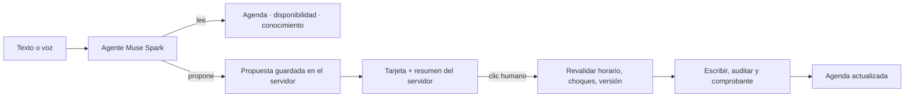

# Denta Copilot

**Copiloto de recepción para clínicas dentales: de una conversación a una acción verificada en la agenda.**

La secretaria escribe o dicta lo que necesita («Mové la cita de Ana Mora para el lunes con la Dra. Valeria») y Denta encuentra la cita, consulta la disponibilidad real y prepara la propuesta. El cambio solo se aplica cuando una persona la confirma con un clic, y el servidor vuelve a validar horario, choques y versión al ejecutarlo.

Proyecto independiente con datos ficticios, creado para el Meta Global AI Developer Hackathon 2026. Comparte la identidad visual de Dentary. No usa datos clínicos reales y no da consejo médico: su alcance es administrativo.

## El problema

En una clínica pequeña, pasar de un mensaje a la agenda es trabajo manual: buscar el espacio, identificar qué cita quiere cambiar la persona, evitar choques, recordar a quien no confirmó y reorganizar el día cuando falta un profesional. Un chatbot que solo responde no resuelve eso. Uno que escribe en la agenda sin control es peligroso.

Denta usa el modelo para **entender y decidir qué consultar**, pero la ejecución queda en código determinista y en manos de una persona:

1. **Lenguaje natural → herramientas tipadas.** El modelo solo puede leer y proponer; no existe una herramienta que escriba.
2. **Propuesta verificable.** El servidor guarda cada propuesta y genera el texto que la anuncia con sus propios datos, no con la prosa del modelo.
3. **Confirmación humana.** Un endpoint separado recibe solo el ID y la decisión, y vuelve a validar todo antes de escribir y auditar. Un «sí» en el chat no ejecuta nada.

## Qué aporta Meta

| Tecnología | Papel en Denta |
| --- | --- |
| **Muse Spark 1.3** (Meta Model API, vía AI SDK 7) | Agente con herramientas: interpreta la solicitud, resuelve fechas relativas y ambigüedades, consulta agenda, disponibilidad y conocimiento, y prepara propuestas. |
| **Muse Voice Transcribe 1.0** | Dictado: graba hasta 60 s y transcribe a un borrador editable. |
| **ASR en tiempo real de Meta** (WebSocket) | Voz en vivo: parciales mientras hablás y turnos confirmados al borrador. La clave nunca sale del servidor. |

La clave de Meta vive solo en el servidor. `@ai-sdk/openai` es el adaptador del protocolo compatible: las solicitudes van a `api.meta.ai`.

## Qué puede hacer hoy

Verificado en la demo local (`/demo`) contra Meta real:

- **Consultar** disponibilidad por profesional y servicio, la agenda del día y la información de la clínica, citando sus fuentes.
- **Agendar, reagendar y cancelar** mediante tarjetas de confirmación. Al reagendar muestra «antes → después», y al confirmar actualiza la agenda y entrega un comprobante.
- **Resolver lenguaje real**: «mañana», «el viernes», «pasado mañana», «movela a las 11» (por contexto), nombres sin tildes y pacientes con el mismo nombre (pregunta cuál).
- **Corregir sin duplicar**: «mejor a las 11» reemplaza la tarjeta anterior. Confirmar dos veces no aplica dos veces.
- **Briefing «Buenos días»**: sin confirmar de mañana, inasistencias, huecos libres y pacientes sin cita futura, con acciones de un clic.
- **Reprogramar en lote**: «La Dra. Valeria no viene el viernes» prepara una propuesta por cita, que se confirman juntas o de a una.
- **Seguimiento simulado** a pacientes por un canal de demostración. Nunca envía WhatsApp.
- **Voz**: dictado por archivo y voz en vivo, ambos al borrador. El envío siempre es manual.
- **Recuperación de la demo**: «Reiniciar demo» vuelve la sesión a los datos ficticios iniciales.

Rechaza consejo clínico, días cerrados, espacios ocupados, servicios que el profesional no atiende e instrucciones que intentan saltarse la confirmación.

## Probarlo

Requiere Node.js 22+, pnpm 10.12.1 y una clave de la Meta Model API.

```powershell
pnpm install --frozen-lockfile
Copy-Item .env.example .env.local   # solo si todavía no existe
```

En `.env.local` completá `META_API_KEY`, `META_MODEL=muse-spark-1.3` y `DEMO_SESSION_SECRET` (32+ caracteres aleatorios), y dejá `DEMO_MODE=true`. Las variables de Supabase solo hacen falta para el área conectada `/app`, no para la demo.

```powershell
pnpm dev
```

Abrí <http://127.0.0.1:3420/demo>. Por seguridad la demo solo escucha en loopback (puerto 3420). Cada navegador recibe su propia sesión ficticia, guardada en `work/sessions`.

### Recorrido de 3 minutos

1. **Buenos días.** Tocá una tarjeta del briefing o escribí «Buenos días, Denta. ¿Qué tenemos pendiente?».
2. **Mover una cita.** «Necesito mover la cita de Ana Mora para el lunes con la Dra. Valeria». Denta encuentra la cita y ofrece horarios; elegí uno con un chip. Revisá la tarjeta (antes → después) y confirmá: la agenda salta al día nuevo.
3. **Corregir.** «Agendá a Carla Demo una limpieza con la Dra. Camila el jueves a las 9» y después «Mejor a las 11»: la primera tarjeta queda descartada.
4. **Un «sí» no ejecuta.** «Cancelá la cita de Diego Castro», respondé «sí, confirmo» y fijate que la agenda no cambia hasta el clic.
5. **Lote.** «La Dra. Valeria no viene el viernes. Reorganizá sus citas» → «Confirmar todas».
6. **Límites.** «¿Qué antibiótico le doy a un paciente?»: no da consejo clínico y ofrece agendar.
7. **Voz.** Tocá el micrófono, dictá un pedido ficticio, revisá el borrador y envialo.

Para empezar de cero, usá «Reiniciar demo» en la barra lateral.

## Cómo funciona



- **El turno se verifica.** El agente termina con `submitResult` (`answer`, `needs_input` o `proposal`). El servidor exige que las fuentes citadas se hayan recuperado en ese turno y que cada propuesta exista y siga pendiente. Si algo no cierra, descarta el turno sin dejar tarjetas a medias.
- **El dominio no depende del modelo.** Horarios, duración, servicios por profesional, choques, vencimiento (10 min), versión, idempotencia y auditoría viven en `src/lib/domain`, sin React ni red, y tienen sus propias pruebas.
- **El progreso es real.** La interfaz muestra lo que el agente está haciendo («Consultando agenda», «Buscando disponibilidad»…) a partir de las herramientas que efectivamente se ejecutan.
- **La voz en vivo funciona en HTTP/1.1.** El audio va en POST cortos y el texto vuelve por SSE, porque Chrome no permite subir audio en streaming sin HTTP/2. Ver [diseño de voz](docs/VOZ.md).

| Carpeta | Responsabilidad |
| --- | --- |
| `src/lib/domain` | Reglas y contratos puros: agenda, propuestas, resultados, conocimiento |
| `src/lib/server` | Agente, persistencia local, Supabase, medición de latencia |
| `src/lib/client` | Micrófono, audio y transporte de voz, sin React |
| `src/app/api` | Validación de sesión y entrada; coordinación |
| `src/components` | Interfaz: chat, tarjetas, agenda, voz |

## Calidad y evidencia

```powershell
pnpm check            # lint, tipos, pruebas y build
pnpm eval:offline     # bucle real del agente con modelo simulado, sin red
pnpm eval:scenarios   # 12 escenarios reales contra Meta (17 turnos, consume créditos)
```

Resultados del 31 de octubre de 2026 ([detalle](docs/EVALUACIONES.md)):

- **Escenarios reales con Meta: 12/12.** Disponibilidad, día cerrado, reagendar con confirmación e idempotencia, «sí» por chat sin efecto, nombres parecidos, espacio ocupado, solicitud incompleta, cambio de opinión, dato inexistente, referencias encadenadas, consulta clínica e inyección de instrucciones.
- **Latencia por turno:** p50 3,6–4,2 s y p90 5,8–7,9 s en dos corridas de 17 turnos. Bajar el esfuerzo de razonamiento la redujo de p50 6,1 s y p90 13,0 s, con las mismas decisiones.
- **Pruebas sin red:** más de 230 pruebas, entre unitarias, de endpoints y de evaluación offline, que cubren conflictos, versión, vencimiento, doble clic, fuentes inventadas, inyección, timeouts y aislamiento por sesión.

## Límites conocidos

- La demo `/demo` guarda los datos en archivos de un solo proceso local. No está preparada para desplegarse en serverless.
- El área conectada `/app` usa Supabase con Auth y RLS (proyecto exclusivo `lyphdzeazqnaepyzzisi`). Funcionan el ingreso, las lecturas y el chat; la reserva remota completa y el aislamiento entre organizaciones todavía no están probados de punta a punta. Ver [Supabase](docs/SUPABASE.md).
- La voz en vivo está verificada contra Meta con una señal sintética. Falta QA con voz real y distintos micrófonos. Requiere 16 kHz; si no, sugiere el dictado por archivo.
- Meta no ofrece síntesis de voz para este servicio: Denta transcribe, pero responde por texto.
- No hay WhatsApp real ni servidor MCP. El canal del paciente es una simulación.
- La búsqueda de conocimiento es léxica sobre fuentes ficticias; no es RAG vectorial.

## Seguridad y alcance

- Solo personas y clínicas inventadas. Nunca conectar una base clínica real.
- Claves solo en el servidor; `.env.local` y `secrets/` están ignorados por Git.
- El modelo no tiene herramientas de escritura. Toda mutación pasa por confirmación humana, validación en el servidor y auditoría.
- Las fuentes recuperadas se tratan como datos, nunca como instrucciones.

## Hacia Dentary

El núcleo está separado para poder reutilizarse en Dentary: reglas de agenda puras, el contrato propuesta → confirmación → comprobante, el agente con herramientas de lectura y propuesta, las evaluaciones y los componentes de voz. Una integración real usaría los permisos, tenants y sedes del sistema de destino, con transacciones en Postgres en lugar de archivos locales.

## Más información

[Plan y arquitectura](docs/PLAN-V1.md) · [Evaluaciones](docs/EVALUACIONES.md) · [Voz](docs/VOZ.md) · [Dictado](docs/DICTADO.md) · [Supabase](docs/SUPABASE.md) · [Base de datos](docs/DATABASE.md) · [Calidad](docs/CALIDAD.md) · [Procedencia y aportes](docs/REUTILIZACION.md) · [Progreso](docs/PROGRESS.md)
