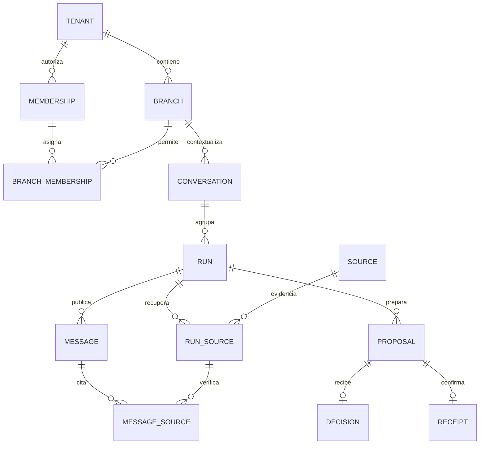

# Base de datos del copiloto

## Estado y objetivo

Migración inicial aplicada el 29 de octubre de 2026 exclusivamente a `lyphdzeazqnaepyzzisi` mediante el MCP `denta-migrations`. El historial remoto registra `20261030052720_initial_copilot_storage`; el archivo local `supabase/migrations/20261030052720_initial_copilot_storage.sql` usa esa misma versión. Supabase CLI 2.122.0 creó el archivo inicial y MCP asignó la versión al aplicarlo; se sincronizó el nombre local sin repetir DDL ni modificar el historial remoto. Consolida los siete archivos de diseño originales en una sola unidad y fue probada en PostgreSQL local con datos inventados. La aplicación continúa usando `work/sessions`.

El MCP `denta-supabase` permanece restringido al mismo proyecto, con `supabase_read_only_user` y `transaction_read_only=on`. Antes del despliegue se verificó PostgreSQL 17.11, `public` sin tablas e historial vacío. Ya existían `public`, `extensions` y `pgcrypto`; la migración instaló `btree_gist` 1.7 y creó `copilot_private`. El conector anterior sigue sin permiso sobre este proyecto; no debe usarse otro proyecto como alternativa.

Verificación remota posterior desde la conexión de solo lectura: 20 tablas con RLS habilitado y forzado, 20 políticas SELECT, cero grants directos de escritura a `anon`/`authenticated`/`service_role`/`PUBLIC`, ocho RPC públicas INVOKER ejecutables por servidor y ninguna por anónimos o usuarios. Las 16 funciones privadas DEFINER fijan `search_path`; únicamente los tres helpers de lectura están concedidos a `authenticated`, ninguno a `anon`. No se cargaron fixtures: organizaciones y citas siguen en cero. Esto comprueba el esquema y sus ACL, no el flujo completo de Auth/JWT/HTTP.

El objetivo es conservar conversaciones, propuestas y comprobantes útiles para una futura integración con Dentary, dejando la agenda ficticia como adaptador reemplazable. Esto no certifica compatibilidad con el esquema ni con las APIs actuales de Dentary: no se consultaron sus datos ni se copió código corporativo.

## Separación de responsabilidades

| Grupo           | Tablas                                                                                                                                 | Responsabilidad                                                                                            |
| --------------- | -------------------------------------------------------------------------------------------------------------------------------------- | ---------------------------------------------------------------------------------------------------------- |
| Acceso          | `dc_tenants`, `dc_branches`, `dc_memberships`, `dc_branch_memberships`                                                                 | Organización, sede, rol y asignación explícita a sedes.                                                    |
| Conversación    | `dc_conversations`, `dc_runs`, `dc_messages`, `dc_run_events`                                                                          | Dueño de la conversación, turnos, mensajes y progreso operativo sin razonamiento privado.                  |
| Evidencia       | `dc_sources`, `dc_run_sources`, `dc_message_sources`                                                                                   | Fuentes versionadas, recuperadas realmente en un turno y seleccionadas en una respuesta.                   |
| Acción          | `dc_proposals`, `dc_decisions`, `dc_receipts`                                                                                          | Comando congelado, decisión humana y comprobante del efecto confirmado.                                    |
| Agenda ficticia | `dc_demo_professionals`, `dc_demo_services`, `dc_demo_offerings`, `dc_demo_business_hours`, `dc_demo_closures`, `dc_demo_appointments` | Catálogo, horarios y citas de demostración; reemplazables por servicios autorizados del sistema anfitrión. |

No se crean pacientes, expedientes, facturas, diagnósticos ni archivos de audio. `patient_label` es exclusivamente una etiqueta ficticia de la demo.



Los identificadores son UUID; las relaciones entre recursos llevan claves compuestas de organización y sede. Un UUID correcto de otra organización no satisface la relación. La agenda comparte un profesional entre sedes de una organización y evita solapamientos incluso entre esas sedes.

Fechas de ejecución en `timestamptz`, zona IANA por sede y horarios semanales en hora local. Los intervalos de citas son semiabiertos `[inicio, fin)`: dos citas contiguas son válidas. La demo no admite horarios nocturnos que crucen medianoche. Precios en unidades menores enteras y moneda ISO de tres letras; no constituyen un libro de facturación.

## Autorización y frontera del modelo

Las 20 tablas tienen RLS habilitado y forzado. `anon` no lee. `authenticated` puede leer recursos de sus sedes autorizadas; las conversaciones, propuestas y comprobantes además pertenecen al usuario que inició esa conversación. La agenda ficticia es compartida por sede. Un administrador también necesita asignación explícita a cada sede. Un usuario `viewer` no prepara ni confirma acciones.

Ni el navegador ni el modelo reciben acceso de escritura a tablas o RPC de mutación. Las RPC públicas son `SECURITY INVOKER`, ejecutables únicamente por `service_role`; delegan a funciones limitadas en `copilot_private`, un esquema que no debe exponerse por PostgREST. Las implementaciones privilegiadas fijan `search_path` y verifican membresía, sede y conversación. Se revocan explícitamente los permisos predeterminados de ejecución. Tampoco se conceden escrituras directas sobre tablas a `service_role`.

**El parámetro `p_actor` es una afirmación del servidor autenticado.** El futuro endpoint debe obtenerlo de una sesión verificada, nunca del body del navegador ni de argumentos del modelo. La base comprueba los permisos de ese actor, pero no demuestra por sí sola que una persona hizo clic. El endpoint de decisión debe permanecer separado del catálogo de herramientas del modelo, validar origen/sesión/entrada y aceptar solamente la propuesta y aprobar/rechazar.

El cliente administrativo futuro será exclusivamente de servidor, con destino validado por `getSupabaseConfig`; todavía no está implementado. El cliente publicable actual no adquiere esos privilegios. Las lecturas de usuario deberán llevar su JWT para que RLS aplique `auth.uid()`; no se harán mediante una credencial privilegiada para luego filtrar visualmente.

## Vida de un turno y una acción

1. El servidor abre una conversación y comienza un turno con identificador de solicitud y huella de entrada. Repetir la misma solicitud devuelve el mismo turno; reutilizarla con otros datos falla.
2. Las herramientas registran fuentes recuperadas y preparan propuestas `draft`. Todavía no afectan la agenda y no se muestran como acciones confirmables.
3. `dc_publish_run` exige las propuestas exactas del turno y fuentes que realmente se recuperaron en ese turno. Publica el mensaje y sus referencias en la misma transacción. El modelo no puede publicar un resultado `executed`; el servidor genera el texto pendiente de las propuestas.
4. Al cancelar, fallar o pausar antes de publicar, los borradores quedan `discarded`. Una respuesta tardía no puede volver a publicarlos. Una desconexión después de publicar no revierte una decisión ya disponible.
5. El endpoint humano llama `dc_decide_demo_proposal`. Se vuelven a validar permisos, vencimiento, versión de cita, catálogo, disponibilidad, horario y cierres. Un catálogo cambiado exige preparar otra propuesta.
6. Cita, decisión, comprobante y estado confirmado se guardan atómicamente. Un fallo al persistir el comprobante revierte el efecto completo. Repetir la misma decisión devuelve el comprobante congelado; una decisión opuesta falla. Rechazar o vencer no produce comprobante de ejecución.

La propuesta conserva versión del comando y backend. Las funciones actuales ejecutan únicamente `demo`; `dentary` no dispone de ejecutor. El comprobante guarda una instantánea del recurso al ejecutar: sigue siendo evidencia de esa acción aunque luego la cita se reagende o cancele.

La confirmación bloquea sede, propuesta y cita en orden; vuelve a consultar el reloj después de esperar bloqueos. Una restricción GiST impide dobles reservas por profesional, incluso con transacciones en distintas sedes. Los cambios de configuración bloquean la sede; los futuros endpoints administrativos deberán conservar el orden de bloqueos y manejar errores transitorios. No se hacen llamadas de red dentro de estas transacciones.

Los comprobantes y decisiones son inmutables para los roles de aplicación. Esto no es un registro inviolable frente al administrador de PostgreSQL. Eliminar un usuario anonimiza los enlaces de actor y conserva los comprobantes; no elimina los datos que pudiera contener una instantánea. En esta fase todos son ficticios.

## Integración posterior con Dentary

| Concepto del copiloto                  | Integración prevista                                                                                                                  |
| -------------------------------------- | ------------------------------------------------------------------------------------------------------------------------------------- |
| Organización, sede y actor             | Resolver desde la sesión y las relaciones existentes del anfitrión. No crear un segundo sistema de permisos si el existente sirve.    |
| Profesional, servicio y disponibilidad | Consultar servicios autorizados de Dentary; mantener sus identificadores y reglas como autoridad.                                     |
| Persona de la cita                     | Exigir referencia a un paciente existente y autorizado. Nunca crear ni identificar pacientes automáticamente por una etiqueta/nombre. Estado Fase 4: bloqueado por diseño; `denyPatientAccess` falla cerrado y la UI comunica que las citas las gestiona recepción. Requiere tabla de pacientes y enlace verificado antes de cualquier recorrido propio. |
| Comando propuesto                      | Adaptador versionado que traduce la intención al contrato del anfitrión y conserva referencia, versión y vencimiento.                 |
| Confirmación                           | Ejecutar mediante el servicio transaccional del anfitrión, con autorización y revalidación al momento del clic.                       |
| Comprobante                            | Conservar ID y versión del efecto devueltos por el anfitrión; mostrar éxito solamente cuando haya evidencia verificable.              |

Si copiloto y Dentary usan bases distintas, una transacción PostgreSQL local no hace atómica una llamada HTTP externa. Antes de habilitar ese adaptador se necesita idempotencia en el anfitrión, registro durable del intento y reconciliación de resultados desconocidos, por ejemplo mediante outbox. Un timeout no demuestra que la escritura falló y no habilita reintentos ciegos. Este mecanismo aún no está implementado.

Se reutilizan conceptos, contratos e invariantes de prueba. No se propone copiar estas 20 tablas dentro de Dentary sin revisar sus relaciones existentes. Tampoco se requiere conectar Dentary para terminar la demo.

## Comprobación reproducible

```powershell
pnpm db:check
```

Requiere Docker en ejecución y acceso a la imagen oficial de PostgreSQL fijada por digest en `scripts/check-database.mjs` (17.11 al preparar este diseño). Crea un contenedor único y efímero sin red ni puertos publicados, con almacenamiento temporal en memoria. Aplica las migraciones versionadas en orden dentro de una transacción, carga exclusivamente fixtures ficticios y elimina su propio contenedor al terminar. No lee `.env.local`, no usa Supabase ni necesita claves. La autenticación local `trust` existe solo dentro de ese contenedor sin red.

Cobertura:

- RLS en todas las tablas, acceso anónimo denegado, aislamiento entre organizaciones y sedes, conversación privada y rol de solo lectura.
- Escrituras directas y RPC desde `authenticated` rechazadas; autorización renovada incluso al repetir una decisión ya tomada.
- Solicitudes idempotentes, fuentes no recuperadas rechazadas, borradores ocultos, cancelación y publicación tardía.
- Reservar, reagendar, cancelar, comprobantes históricos, vencimiento, cambios de precio, cierre y versión entre propuesta y confirmación.
- Fallo inyectado al guardar un comprobante: ninguna cita o decisión parcial queda persistida.
- Dos conexiones reales compitiendo por un doble clic, por la misma hora en una sede y por el mismo profesional en sedes diferentes. La última prueba exige el error de la restricción de exclusión.

La prueba usa un sustituto mínimo de `auth.users` y `auth.uid()` para simular roles y sujetos. **No valida GoTrue, JWT reales, PostgREST, sesión HTTP ni la conexión de la app a Supabase.** No es una prueba de carga ni certificación de producción. `pnpm check` sigue validando la aplicación; `db:check` es separado para no exigir Docker en cada cambio de UI.

## Antes de activar persistencia remota

1. Completar la revisión de esquemas expuestos por Data API desde el dashboard: `copilot_private` debe permanecer fuera. Los MCP habilitados con `features=database` no exponen advisors; falta la revisión oficial de seguridad por esa vía o el dashboard. El esquema y las ACL sí se verificaron por SQL. No reemplazar el proyecto si falta acceso.
2. Conservar la migración inicial aplicada y su versión sincronizada. Para futuras modificaciones, crear otra migración y probarla localmente antes de aplicarla. No separar tablas, políticas y revocaciones en despliegues intermedios ni aplicar el bootstrap/fixtures de pruebas remotamente.
3. Integrar Auth y sesión de servidor; emitir tipos del esquema y crear el adaptador de persistencia con contratos validados. Decidir explícitamente cómo importar o descartar sesiones ficticias locales; no hacer fallback silencioso a archivos cuando falle una escritura remota.
4. Probar el flujo completo con usuarios ficticios y JWT reales de dos organizaciones/sedes: navegador → endpoint → RPC → RLS → resultado. Comprobar que el modelo sigue sin capacidad de confirmar.
5. Probar recuperación tras caída del proceso y turnos abandonados. Los estados están modelados, pero no existe todavía un worker que los recupere.
6. Definir retención aprobada y borrado. Hay un límite provisional de conversación de 30 días, sin job de purga; las tablas inmutables requieren un procedimiento de retención deliberado. No interpretar esto como una política legal.

La fuente guarda versiones y huellas de contenido con índice léxico español; falta implementar selección de versión vigente y recuperación desde la app. No se incorporan embeddings ni otro servicio por anticipado.

## Activar la persistencia de la app (pendiente de clave administrativa)

La configuración actual solo tiene la clave publicable; no hay clave administrativa local y no se inventa ninguna. Sin ella, la app conserva explícitamente la demo local y rechaza el modo conectado con 503, sin fallback silencioso.

1. Obtener la clave secreta desde el dashboard del proyecto `lyphdzeazqnaepyzzisi` (Settings → API → Secret key). Nunca usar una clave de otro proyecto ni prefijarla con `NEXT_PUBLIC_`.
2. Guardarla solo en `P:\denta-copilot\.env.local` como `SUPABASE_SERVICE_ROLE_KEY=<valor>`. El archivo está ignorado por Git. No imprimirla ni pegarla en el chat.
3. Reiniciar `pnpm dev` para cargar el entorno.
4. Aplicar `supabase/seeds/demo-secretaria.sql` desde el SQL editor (una vez por reset).
5. Aplicar `supabase/seeds/grant-membership.sql` con el UUID real del usuario de prueba Auth.
6. Verificar: ingresar en la app, elegir la sede, consultar disponibilidad, pedir reserva, confirmar con clic, comprobar el comprobante y recargar para confirmar persistencia.

Verificado localmente en este corte: Auth con sesión firmada (15 pruebas), adaptador RPC con actor de sesión (5 pruebas), mapeo de vista conectada y husos horarios (4 pruebas), agente conectado con publicación verificada y aborto con descarte (3 pruebas), `pnpm db:check` con concurrencia real. Pendiente remoto: login E2E con la cuenta de prueba, recorrido completo contra Supabase y reintentos/idempotencia entre procesos.

## Acceso para aplicar la migración

`denta-supabase` es la conexión de inspección en solo lectura. `denta-migrations` es la conexión de mantenimiento, autorizada por OAuth por la participante y restringida mediante `project_ref=lyphdzeazqnaepyzzisi&features=database`, con las confirmaciones predeterminadas. Se verificó su URL antes de aplicar la migración. No se usaron herramientas de cuenta, otros proyectos ni claves de Dentary/ECP.

La creación de tablas por sí sola no habilita la app: Auth, membresías ficticias y las pruebas con JWT reales continúan como un corte separado. El modelo de la aplicación mantiene únicamente herramientas de lectura/propuesta; la conexión MCP de mantenimiento del desarrollador no forma parte de ese catálogo.

Referencias: [RLS de Supabase](https://supabase.com/docs/guides/database/postgres/row-level-security), [funciones y privilegios](https://supabase.com/docs/guides/database/functions) y [rangos y exclusión de PostgreSQL](https://www.postgresql.org/docs/current/rangetypes.html).
