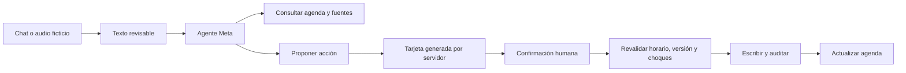

# Denta Copilot · Idea, arquitectura y plan V1

Fecha: 27 de octubre de 2026. Estado: primera base funcional local; V1 de competencia en desarrollo.

## La idea

Una clínica pequeña pierde tiempo pasando de conversaciones a una agenda: buscar un espacio, aclarar qué cita quiere cambiar la persona, evitar choques y mantener el contexto. Denta Copilot actúa como secretaria administrativa: entiende la solicitud, consulta información verificable y prepara una acción concreta dentro de la aplicación. La persona conserva el control mediante una tarjeta de confirmación.

La demostración usa una clínica y personas inventadas con situaciones realistas. El valor está en resolver operaciones de principio a fin y dejar evidencia del resultado. La búsqueda de conocimiento apoya al agente; el producto principal es la ejecución controlada de acciones. El proyecto funciona de forma independiente y su dominio TypeScript puede servir después para explorar funcionalidades de Dentary.

## Hackathon y posicionamiento

Se leyeron las reglas del canal oficial [rules](https://discord.com/channels/1557169028080869426/1557169028626251800) en Chrome el 27 de octubre:

- Trabajo presentado construido durante el evento: 26 de octubre–4 de noviembre de 2026. Deben distinguirse las contribuciones nuevas.
- Repositorio público en la entrega, video de tres minutos y equipo agregado.
- Una única pista de participante: Indie Developer o Startup. Hasta cuatro integrantes.
- Tema sugerido para este proyecto: Build for Your World, sujeto a la selección de la participante.
- Las reglas desaconsejan RAG básico y consejo médico de IA. La propuesta se concentra en operaciones administrativas y acciones verificables.
- La fecha publicada es 4 de noviembre a las 21:00 ET: 20:00 en Costa Rica ese día. Revisar el formulario oficial antes de entregar.

No se ha enviado inscripción, publicación ni aceptación de términos desde este proyecto. La elegibilidad final depende de las reglas oficiales y de la participante. El diseño anterior y toda dependencia deben identificarse; no presentar una funcionalidad existente de otro sistema como trabajo nuevo del evento.

## Stack elegido

| Capa           | Elección                                               | Motivo                                                                          |
| -------------- | ------------------------------------------------------ | ------------------------------------------------------------------------------- |
| Aplicación     | Next.js 16, React 19, TypeScript                       | Compatible con el stack de Dentary, frontend y rutas de servidor en un proyecto |
| Agente         | AI SDK 7, `ToolLoopAgent`                              | Herramientas tipadas y bucle limitado, sin reimplementar el ciclo del modelo    |
| Proveedor      | Meta Model API directo; Muse Spark 1.3                 | Usa la clave de la participante. Modelo comprobado mediante `/models`           |
| Audio inicial  | Muse Voice Transcribe 1.0, archivo WAV                 | Audio → texto editable → mismo flujo y permisos del chat                        |
| Datos objetivo | Proyecto nuevo de Supabase, Postgres y Auth            | Separación completa de la base real de Dentary                                  |
| Diseño         | Tokens semánticos derivados de Dentary; interfaz nueva | Continuidad de marca y futura reutilización                                     |
| Calidad        | Vitest, ESLint, TypeScript y build                     | Cubrir invariantes y compilar antes de integrar                                 |

La elección explícita de AI SDK y Meta directo evita introducir otro runtime de agentes o un gateway externo en este primer corte. `@ai-sdk/openai` es el adaptador del protocolo compatible: las solicitudes van a `api.meta.ai`, no a OpenAI.

## Flujo y límites de confianza

El modelo solo tiene herramientas de lectura y propuesta. La confirmación usa un endpoint separado que recibe exclusivamente el ID de la propuesta y la decisión. El navegador no puede modificar sus parámetros al aprobarla. Un «sí» en el chat no equivale al clic. El servidor vuelve a validar el espacio al ejecutar.

El contexto conversacional se lee del servidor, con una ventana de 18 mensajes previos y hasta ocho propuestas recientes. El prompt se versiona en código. La agenda se consulta por herramientas; no se pega un expediente completo al contexto. El contenido de las fuentes se trata como datos. Estas instrucciones no equivalen por sí solas a una evaluación completa contra inyección.

## Estado por corte

| Corte                          | Estado                                                        | Criterio de salida                                                                                                                                      |
| ------------------------------ | ------------------------------------------------------------- | ------------------------------------------------------------------------------------------------------------------------------------------------------- |
| 0. Base segura y narrativa     | Hecho local                                                   | Entornos ignorados, dependencias fijadas, idea y procedencia documentadas                                                                               |
| 1. Chat y agenda               | Hecho local                                                   | Meta real consulta, propone, confirma y actualiza datos ficticios                                                                                       |
| 2. Conocimiento y dictado      | Micrófono y WAV a borrador locales                            | Pendientes: validar hardware/voces/acentos y dispositivos del piloto                                                                                    |
| 3. Supabase                    | Esquema remoto aplicado; Auth y persistencia listas sin clave | Clave secreta, semillas, recorrido E2E remoto y RLS con JWT reales probados                                                                             |
| 4. Calidad de conversación     | Contrato, evals, progreso real y latencia medida              | Pendientes: recuperación duradera y presupuesto por sesión. Streaming de tokens descartado deliberadamente: el texto verificable vive en `submitResult` |
| 5. Voz en vivo e integraciones | Verificado: STT realtime por WS; sin TTS/WebRTC               | Puente WS dedicado con presupuesto, o mantener dictado por turnos; MCP/API si aporta a la demo                                                          |
| 6. Entrega                     | Pendiente                                                     | Demo desplegada, QA, aportes identificables, repo público y video de tres minutos                                                                       |

## Diseño de la integración Supabase

Proyecto exclusivo confirmado: **denta**, organización **dentacopilot**, referencia `lyphdzeazqnaepyzzisi`. URL y clave publicable configuradas localmente, migración y semilla controlada aplicadas, ingreso real comprobado. La configuración rechaza otros destinos. El área conectada exige clave de escritura de servidor; sin ella muestra un bloqueo explícito. Ver [estado y límites actuales](SUPABASE.md). `/demo` conserva almacenamiento local.

Modelo propuesto: organizaciones/sedes, membresías, profesionales, servicios, citas, conversaciones, mensajes, propuestas, eventos de auditoría y documentos/fragmentos de conocimiento. Todas las filas de una organización llevan `tenant_id`. RLS debe comprobar pertenencia desde `auth.uid()`, y las claves foráneas deben impedir referencias cruzadas entre organizaciones.

La confirmación debe pasar a una transacción Postgres con bloqueo o exclusión para evitar traslapes del mismo profesional; idempotencia por ID de propuesta y verificación de versión. La cookie de demo y el mutex local se reemplazan por autenticación y transacciones. Probar dos usuarios del mismo tenant compitiendo por el mismo espacio y dos tenants intentando cruzar IDs.

RAG V1: documentos ficticios versionados, fragmentos con título, procedencia y filtros de tenant/sede. Comenzar con búsqueda full text en español; evaluar recuperación híbrida si las pruebas justifican embeddings. La lista actual de modelos Meta consultada no incluye un modelo de embeddings: no asumir que existe ni incorporar un segundo proveedor sin definir su costo. La búsqueda léxica actual es un prototipo, no RAG vectorial.

## Audio, tiempo real, MCP y API propia

La documentación de Meta ofrece transcripción de archivo y ASR en vivo por WebSocket. No equivale a conversación bidireccional con síntesis de voz. WebRTC es un transporte distinto; no seleccionarlo hasta comprobar que el proveedor requerido lo soporta para el caso de uso. Ahora se captura el micrófono con permiso explícito y se convierte a WAV para transcribir a borrador; se responde por texto. Ver [implementación, evidencia y validación manual pendiente](DICTADO.md).

Una integración MCP futura expondría el mismo dominio mediante herramientas con scopes: `agenda:read`, `agenda:propose` y confirmación explícita. Una API key externa se guardaría mediante hash, con tenant, scopes, vencimiento y revocación. Nunca distribuir la clave de Meta a consumidores de nuestra aplicación. No hay MCP ni emisión de API keys implementados en este corte.

WhatsApp será otro adaptador de entrada/salida. Se debe resolver organización y sede de una fuente confiable, deduplicar webhooks y preservar la misma autorización. No hace falta conectarlo para demostrar que el agente actúa dentro de una aplicación.

## Qué conviene llevar después a Dentary

El contrato de resultados y el harness inicial están implementados; ver [evaluaciones y límites](EVALUACIONES.md). Para los siguientes cortes del agente, seguir la [revisión de patrones del taller de Meta](AGENT-PATTERNS.md): resultados verificables, evaluaciones conversacionales, trazas por ejecución y recuperación. El análisis distingue patrones seleccionados de capacidades todavía pendientes.

Las reglas de agenda puras, el contrato de propuesta/confirmación, las pruebas de choques e idempotencia, el manejo de audio a borrador y las evaluaciones del agente. La integración final debe llamar a los servicios y permisos existentes de Dentary; no reemplazar sus restricciones clínicas ni sus políticas multi tenant con las simplificaciones de esta demo.

## Guion propuesto del video

0:00–0:25: problema de recepción y alcance administrativo. 0:25–1:10: consulta contextual y reserva confirmada que aparece en agenda. 1:10–1:55: reagendamiento, cancelación y manejo de un choque. 1:55–2:25: audio ficticio a texto revisado y acción. 2:25–3:00: evidencia de herramientas, trazabilidad, límites y trabajo nuevo del equipo. El guion se ajustará a las capacidades realmente completadas.

## Referencias oficiales consultadas

- [Meta API y autenticación](https://dev.meta.ai/docs/api-reference).
- [Modelos Meta](https://dev.meta.ai/docs/models).
- [Transcripción de archivo](https://dev.meta.ai/docs/api-reference/voice/transcribe).
- [Speech to text y tiempo real](https://dev.meta.ai/docs/speech-to-text).
- [AI SDK](https://ai-sdk.dev/docs), además de documentación incluida en la versión instalada.
- [Supabase Changelog](https://supabase.com/changelog), revisado; sin cambios remotos implementados todavía.
